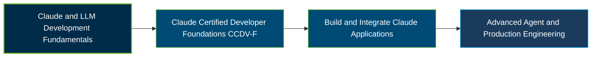

# Anthropic Claude Certified Developer – Foundations Certification Exam Guide

A dedicated study guide and technical reference repository for candidates preparing for the **Anthropic Claude Certified Developer – Foundations (CCDV-F) Certification Exam**, covering Claude application development, API integration, agent workflows, and secure implementation.

---

## Exam Overview

The Claude Certified Developer – Foundations certification validates the ability to build, integrate, test, and ship applications, agents, and workflows using the Claude platform.

- **Exam Format**: Proctored multiple-choice and multiple-response examination, delivered online or at a Pearson VUE test center.
- **Target Audience**: AI and machine learning engineers, software developers, technical leads, and senior engineers building Claude-powered applications.
- **Prerequisites**: No formal prerequisite certification or course is required. Registration is available to members of organizations in the Claude Partner Network.

---

## Core Exam Domains & Knowledge Areas

### 1. Applications and Integration

- Claude Messages API, client SDKs, streaming, vision, and tool interactions.
- Application requirements, REST, JSON, asynchronous programming, and software lifecycle practices.
- Application configuration, session management, schema design, and version control.

### 2. Model Selection and Optimization

- LLM fundamentals, tokens, context windows, and model capabilities.
- Model selection based on quality, latency, and cost considerations.
- Usage tracking, prompt caching, and token-cost optimization.

### 3. Agents and Workflows

- Choosing between deterministic workflows and agent-based approaches.
- Building agents with the Claude Agent SDK and custom execution loops.
- Agent patterns, subagents, memory, and context management.

### 4. Prompt and Context Engineering

- System instructions, prompt structure, examples, and iterative refinement.
- Context-window management, context isolation, and information organization.
- Structured outputs, response validation, and defensive parsing.

### 5. Tools and MCPs

- Function calling, tool definitions, execution, and error handling.
- Model Context Protocol server development, deployment, and transports.
- Selecting built-in tools, custom tools, Skills, and MCP integrations.

### 6. Security and Safety

- Prompt injection mitigation, jailbreak defense, and untrusted input handling.
- Data protection, privacy, identity management, and secret handling.
- Guardrails, least-privilege permissions, and safe application deployment.

### 7. Claude Code

- Claude Code components, including Rules, Skills, Commands, and Agents.
- CLAUDE.md hierarchy, settings, session management, and configuration.
- Headless execution, streaming modes, and development workflows.

### 8. Eval, Testing, and Debugging

- Identifying API errors, model failures, and integration issues.
- Analyzing traces and isolating problems across application components.
- Applying recovery strategies and systematic debugging practices.

---

## Certification Path

---

## Recommended Practice & Study Resources

Combine official Anthropic preparation materials with practical development and focused technical study.

- **CertsGate**: Explore [CCDV-F certification preparation resources](https://certsgate.com/exams/anthropic/ccdv-f), including supplementary practice questions and study materials.
- **Anthropic Documentation & MCP**: Use the [Claude developer documentation](https://docs.anthropic.com/) and [Model Context Protocol documentation](https://modelcontextprotocol.io/) to practice API integration, tool development, agent workflows, and application security.
